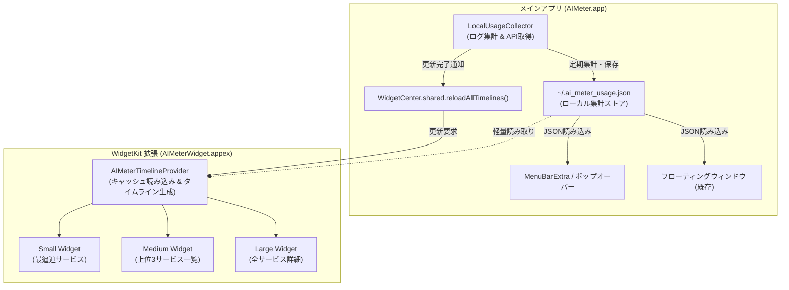
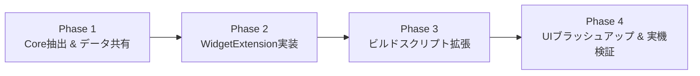

# macOS デスクトップウィジェット（WidgetKit）対応 計画書

## 1. 概要と目的

### 目的
macOS Sonoma (14.0+) のデスクトップウィジェット機能に対応し、ユーザーがデスクトップ壁紙上に直接 AIMeter のウィジェットを配置・常駐できるようにします。

### 現状と課題の整理
- **現状**:
  - 現在の AIMeter には「ウィジェットを表示」機能（`DesktopWidgetWindowAccessor` / `NSWindow` ベースのフローティングウィンドウ）が実装されています。
  - これは通常の常駐ウィンドウであるため、デスクトップ壁紙とのシームレスな統合（Mission Controlでの壁紙貼り付き、ステージマネージャ連動、macOSウィジェットギャラリーからのサイズ選択配置）には対応していません。
- **目標**:
  - Apple 標準の **WidgetKit (App Extension)** を導入し、macOS標準のウィジェットギャラリー（デスクトップ右クリック →「ウィジェットを編集」）から追加可能な正規デスクトップウィジェットを提供します。
  - 既存のメニューバー機能および独自フローティングウィンドウと共存させ、ユーザーが好みの表示スタイルを選択できるようにします。

---

## 2. システム構成とアーキテクチャ



### 2.1 データ共有方式
- **現行ストア**: `~/.ai_meter_usage.json`（パーミッション 0600 のローカルJSON）。
- **拡張機能からの参照**:
  - AIMeter は現在 Ad-hoc 署名（Non-Sandbox）で動作しているため、Widget Extension から直接 `~/.ai_meter_usage.json` を安全に読み取り可能です。
  - **将来の App Sandbox 化 / App Store 配布対応**:
    - App Group（`group.com.local.AIMeter`）の共通ディレクトリへの出力もサポートできる抽象化層（`AIMeterSharedStore`）を用意します。

### 2.2 コード構造の整理（共通化）
WidgetKit Extension からデータモデルやヘルパーを再利用するため、Package 構成をマルチターゲット化します。

```
AIMeter/
├── Package.swift
├── Sources/
│   ├── AIMeterCore/             # [新規] 共通データモデル & ヘルパー
│   │   ├── Models.swift         # LimitPeriod, Metric, LocalUsageData 等
│   │   ├── UsageParser.swift    # タイムスタンプ・期間計算
│   │   └── SharedStore.swift    # JSON 読み込み & App Group 抽象化
│   ├── AIMeter/                 # メインアプリ本体
│   │   ├── AIMeterApp.swift
│   │   ├── LocalUsageCollector.swift
│   │   ├── HelpView.swift
│   │   └── SetupWizardView.swift
│   └── AIMeterWidgetExtension/  # [新規] WidgetKit 実装
│       ├── AIMeterWidget.swift
│       ├── AIMeterTimelineProvider.swift
│       ├── Views/
│       │   ├── SmallWidgetView.swift
│       │   ├── MediumWidgetView.swift
│       │   └── LargeWidgetView.swift
│       └── Info.plist
└── scripts/
    └── build_app.sh             # .appex のパッケージング処理を追加
```

---

## 3. ウィジェット仕様（サイズ別デザイン）

| ファミリー | 推奨表示内容 | 対象ユーザー体験 |
| :--- | :--- | :--- |
| **`systemSmall`** (小) | - **最逼迫サービス**のプログレスリング<br/>- 残り％、残りトークン数<br/>- リセットまでの時間または次回枠 | 最も画面占有率が小さく、危険なサービスのみを監視したい場合 |
| **`systemMedium`** (中) | - **主要 2〜3 サービス**（Claude, Cursor, Codex 等）の残量バー<br/>- 月間推定コスト / 最終更新時刻 | デスクトップの端に置いて日常的に複数AIの使用状況を俯瞰したい場合 |
| **`systemLarge`** (大) | - 全監視サービス（4〜6種）の残量グリッド<br/>- 期間別メトリクス（5時間 / 24時間 / 30日）<br/>- コスト予算の進捗バー | フルスタックでAIツールを併用するパワーユーザー向け |

> [!TIP]
> macOS Sonoma のデスクトップウィジェットは、フォーカスが外れた際に自動的にモノクロ（デスクトップの壁紙に馴染むスタイル）へフェードします。
> SwiftUI 標準の `.containerBackground` や階層的カラー (`.secondary`, `.tertiary`) を活用することで、macOS ネイティブの壁紙ブレンドに自然に対応させます。

---

## 4. 実装フェーズとステップ



### Phase 1: モデル共通化 (`AIMeterCore`) の分離
1. `Package.swift` に `AIMeterCore` ターゲットを定義。
2. `LimitPeriod`, `PeriodUsageMetric`, `LocalUsageData`, `ServiceBottleneck` などの型定義を抽出。
3. 既存の `AIMeter` および `AIMeterTests` がこれまで通り 100% 動作・パスすることを確認。

### Phase 2: WidgetKit 実装 (`AIMeterWidgetExtension`)
1. `AIMeterWidget.swift`: `@main struct AIMeterWidgetBundle: WidgetBundle` の定義。
2. `TimelineProvider`:
   - `placeholder`: サンプルデータ表示
   - `getSnapshot`: ギャラリー用プレビュー
   - `getTimeline`: 最新キャッシュから生成、次回更新エントリーのスケジューリング（15分間隔）
3. `Small`, `Medium`, `Large` の SwiftUI ビューを実装。
4. メインアプリ側の集計完了フックに `WidgetCenter.shared.reloadAllTimelines()` を組み込み。

### Phase 3: ビルド & バンドル自動化 (`build_app.sh`)
1. `swift build -c release --target AIMeterWidgetExtension` の実行。
2. 生成バイナリを `AIMeter.app/Contents/PlugIns/AIMeterWidget.appex/Contents/MacOS/` に配置。
3. `AIMeterWidget.appex/Contents/Info.plist`（`NSExtensionPointIdentifier = com.apple.widgetkit-extension`）を自動生成。
4. バンドル全体のコード署名（`codesign --deep`）を更新。

### Phase 4: 検証と動作確認
- macOS 14 / 15 環境でのウィジェットギャラリー認識テスト。
- Small / Medium / Large のデスクトップ配置テスト。
- メインアプリでのログ集計・APIキー更新がウィジェットにリアルタイム反映されるかの検証。
- ダークモード / ライトモード / 壁紙フェード時の視認性確認。

---

## 5. リスクと対策

| リスク | 対策 |
| :--- | :--- |
| **WidgetKit の起動遅延・更新遅延** | 拡張側では重いログ走査を一切行わず、メインアプリが集計した `~/.ai_meter_usage.json` のキャッシュをパースするのみとし、0.01秒未満で応答。 |
| **Ad-hoc 署名環境での Extension 認識** | macOS では Ad-hoc 署名でも適切な `Info.plist` と `Contents/PlugIns/` 構造があればウィジェットとして認識されます。初回登録時に `pluginkit -a` やアプリアイコン再起動の案内をサポート。 |
| **既存の未コミット作業との競合** | 現行の `AIMeterApp.swift` 変更分に干渉しないよう、新ファイル (`AIMeterCore`, `AIMeterWidgetExtension`) 中心で進めます。 |
