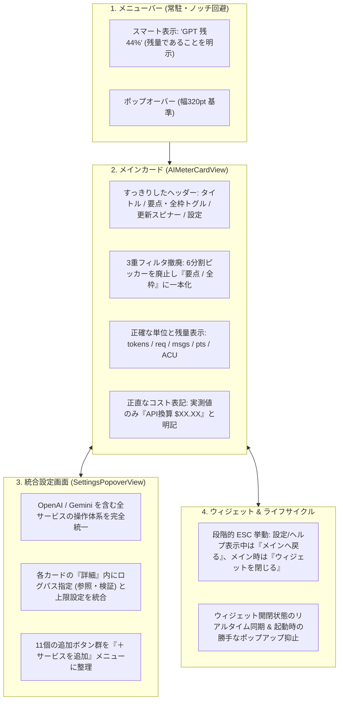

# AIMeter UX抜本改善・シンプル化 実装計画書 (v2)

## 1. ゴールと設計原則

AIMeter の最大の強みである **「Mac 内のローカルログからゼロ設定・ゼロ外部通信で AI の残り枠を即座に把握できる」** 体験を研ぎ澄まし、認知負荷と操作の迷いをゼロにします。

### 4つの設計原則（Simplicity Principles）
1. **ゼロ設定で即表示**: 初回起動時に巨大なウィザードでブロックせず、自動検出されたライブメーターを即座に表示する。
2. **設定画面の一本化**: 「初期セットアップ」と「設定」の二重構造を廃止し、1つの「設定」画面で ON/OFF・メニューバー表示・ログパス指定・上限変更を完結させる。
3. **正直なデータ表示**: 取れないデータの推測値（Windsurf の日次/週次捏造）や、未使用ツールの固定費計上（`$20` ハードコード）、定額プランと従量換算額の無差別合算を排除する。
4. **一貫したウィンドウ＆キー操作**: 画面遷移での激しい横幅ジャンプ（310pt ⇔ 550pt）を抑え、`ESC` キーで「設定から戻る」と「ウィジェットを閉じる」が段階的に動く自然な macOS 体験にする。

---

## 2. 改善アーキテクチャ全体像

---

## 3. フェーズ別・詳細実装タスク

### Phase 1: データと数値の「正直化」＆単位の正確化
対象ファイル: `Sources/AIMeter/LocalUsageCollector.swift`, `Sources/AIMeter/AIMeterApp.swift`

- [x] **推測値（捏造データ）の廃止**
  - `LocalUsageCollector.collectWindsurf` で月間メッセージ数に `×0.35`（週次）、`×0.08`（1日）を掛けていた推測計算を削除し、実測できる月次（`30d`）のみを記録。
  - `CustomSubscriptionConfig.windsurfPreset()` のデフォルト有効期間を `["30d"]` に変更。
  - `UsageMonitor.refresh()` 内の OpenAI / Gemini に対する `0.45 / 0.12 / 0.05 / 0.02` の推測フォールバックを削除し、`LocalUsageCollector` の実測バケット値をそのまま反映。
- [x] **架空コスト計上の廃止と「API換算」の明記**
  - `LocalUsageCollector` 内の Claude (`$20.0`)、GrokBot (`$30.0`)、Windsurf (`$20.0`)、Copilot (`$10.0`)、Cursor (`$20.0`) のハードコード固定費フォールバックを撤廃し、実測トークンコストがない場合は `0.0`（または `nil`）を返す。
  - 各プリセット（`claudePreset`, `cursorPreset` 等）の初期 `usedCostUSD` を `0.0` に変更し、使っていないサービスの固定費が勝手に合算される現象を解消。
  - メイン画面・フッターのコスト表記を `月間計 $XX` から **`API換算 $XX.XX`**（`0` の場合は非表示）に変更し、定額サブスク利用者が「高額請求される」と誤解しないように改善。
- [x] **サービス別単位（Unit）の精緻化**
  - `providerUnit(for:)` を拡張し、正確な単位を返すように修正：
    - `openai`, `gemini`, `claude`, `grokbot`, `deepseek`: `"tokens"`（行表示は `残 129M`）
    - `cursor`, `copilot`, `perplexity`, `trae`: `"req"`（`残 277 req`）
    - `windsurf`: `"msgs"`（`残 48K msgs`）
    - `poe`: `"pts"`（`残 850K pts`）
    - `devin`: `"ACU"`（`残 180 ACU`）
- [x] **メニューバー表記の明確化**
  - `menuBarTitle` の `smart` モードを `GPT 残44%`（残量15%未満の逼迫時は `⚠️ GPT 残9%`）、`iconOnly` モードを `残44%` とし、「使用率」ではなく「残り容量」であることを一目で判別可能にする。

---

### Phase 2: メインカードの整理と「3重フィルタ」の解消
対象ファイル: `Sources/AIMeter/AIMeterApp.swift`

- [x] **6分割セグメントピッカーの廃止と「要点 / 全枠」トグルへの一本化**
  - カード上部を圧迫していた `すべて | 2時間 | 5時間 | 1日 | 週次 | 月次` の6分割セグメント（`filterSelection`）を廃止。
  - ヘッダーの謎のアイコンボタン（`rectangle.split.1x2`）を、テキスト付きの分かりやすいピルトグル **「要点 / 全枠」** に変更。
  - ユーザーが設定画面で対象サービスの「表示枠（2h/5h/1d/7d/30d）」をカスタマイズした際は、メイン画面に戻ったときに変更結果がそのまま見えるよう `isDetailedView = true`（全枠表示）へ自動連動。
- [x] **ヘッダーのダイエットと更新フィードバックの追加**
  - メインカードのヘッダーから「？（ヘルプ）」アイコンを移動（設定画面ヘッダーおよびメニューバー下部へ配置）し、幅 320pt 内で要素が窮屈にならないよう整理。
  - 更新ボタン（`arrow.clockwise`）押下時、`monitor.isRefreshing == true` の間は `ProgressView().controlSize(.mini)` に切り替わり、更新中であることが視覚的にわかるように改善。
- [x] **カード内リセット時刻の視認性向上**
  - `5時間リセット 10/19 18:10` のように長くなっていた表記を、`↻ 18:10`（24時間以内）または `↻ 10/25 14:09`（別日）のようにコンパクト化し、サービス名と衝突しないように調整。

---

### Phase 3: 「初期セットアップ」と「設定」の完全統合
対象ファイル: `Sources/AIMeter/AIMeterApp.swift`, `Sources/AIMeter/SetupWizardView.swift`

- [x] **初回起動時のブロッキングウィザード廃止**
  - `!monitor.hasCompletedSetupWizard` による強制ウィザード表示を廃止し、初回起動時から `autoAddDetectedSubscriptions()` で検出されたライブメーターを即座に表示。
- [x] **OpenAI / Gemini とカスタムサービスの操作体系統一**
  - `UsageMonitor` に `@AppStorage("showOpenAIInMenuBar") var showOpenAIInMenuBar: Bool = true` と `@AppStorage("showGeminiInMenuBar") var showGeminiInMenuBar: Bool = true` を追加し、OpenAI / Gemini もメニューバー表示の ON/OFF を個別に切り替え可能にする。
  - OpenAI カードのバッジが常に緑色の「実ログ検出」になっていた不具合を修正し、`openaiUsedTokens > 0 || openaiServerPct != nil` のときのみ「実ログ検出」、カスタムパス指定時は「手動指定」、未検出時は「スタンバイ」と正確に表示する。
- [x] **設定画面（`SettingsPopoverView`）への「ログパス指定」の統合**
  - 各サービスカードの「詳細」展開内に、これまで `SetupWizardView` にしかなかった **ログパス指定 UI（パス入力・`参照...`・`検証 & 適用`・`リセット`）** を統合。
  - これにより、「設定」画面1つで **有効化・メニューバー表示・表示枠・上限値・ログパス指定・APIキー設定** がすべて完結する。
- [x] **11個の追加ボタン群を「＋ サービスを追加」メニューへ整理**
  - 設定画面上部に2段で並んでいた11個の小さなボタン群を廃止。
  - リスト下部にすっきりした **「＋ サービスを追加」プルダウンメニュー（`Menu`）** と **「自動検出」ボタン** を配置。追加済みのプリセットには `✓ 追加済`（disabled）を表示し、重複追加を防止。

---

### Phase 4: ウィンドウ・ライフサイクル・キーボード操作の洗練
対象ファイル: `Sources/AIMeter/AIMeterApp.swift`, `Sources/AIMeter/HelpView.swift`

- [x] **ウィンドウ幅ジャンプの抑制**
  - 従来の `310pt ⇔ 420pt ⇔ 480pt ⇔ 550pt` という4段階の激しいサイズ変動を改め、メイン画面は **`320pt`**、設定・ヘルプ画面は **`380pt`** に統一。`HelpView` も幅 `380pt` に最適化。
- [x] **段階的な `ESC` キー操作**
  - 設定画面（`showSettings`）またはヘルプ画面（`showHelp`）を開いている状態で `ESC` キーを押した際は、ウィンドウを閉じるのではなく **「メイン画面に戻る（`showSettings = false; showHelp = false`）」** 動作にする。
  - メイン画面表示中のみ、`ESC` または `⌘W` でデスクトップウィジェットを閉じる。
- [x] **デスクトップウィジェットの開閉状態トラッキングと起動時挙動の修正**
  - `AIMeterApp.body` の Scene 定義順を `MenuBarExtra` 優先に整理し、起動時に毎回デスクトップウィジェットが強制ポップアップする挙動を抑止。
  - `UsageMonitor` に `@Published var isDesktopWidgetOpen: Bool` を持たせ、ウィジェットの表示・クローズ時にリアルタイム更新することで、メニューバー下部の「ウィジェットを表示 / ウィジェットを閉じる」ボタンの表記ズレを完全に解消。

---

## 4. 検証・テスト計画

- [x] **単体テストの更新・追加（`Tests/AIMeterTests/AIMeterTests.swift`）**
  - `providerUnit(for:)` の新単位（`msgs`, `pts`, `ACU`, `req`, `tokens`）テスト。
  - `menuBarTitle` の各モード（`smart`: `GPT 残44%`, `iconOnly`: `残44%` 等）および OpenAI/Gemini 個別メニューバー非表示時のテスト。
  - Windsurf 等で捏造データや架空の初期コスト（`$20`）が入らないことの検証テスト。
- [x] **ビルド・パッケージング検証**
  - `swift test` による全テスト通過確認。
  - `./scripts/build_app.sh` によるリリースビルド、`AIMeter.app` バンドル生成、アドホック署名、`AIMeter-macos-universal.zip` 生成の確認。
