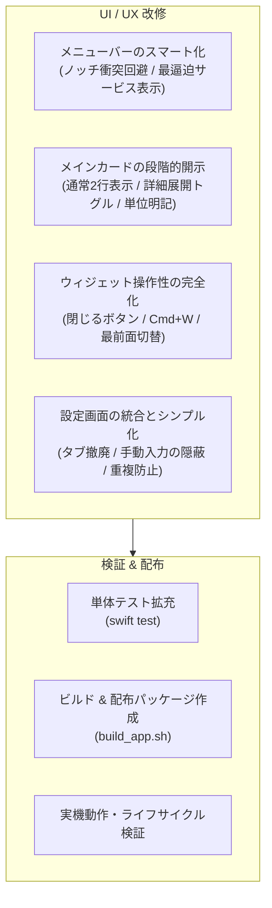

# AIMeter UX改善・シンプル化 実行計画書

## 1. 概要と目標

### 目的
AIMeter の最大の強みである **「Mac 内のログからゼロ通信・高速・安全に利用状況を自動解析する」** というコア価値を前面に出し、**「一目で状況がわかり、普段は作業の邪魔をしない」シンプルで洗練された macOS ネイティブアプリ** の状態を実現します。

### 受入基準（Definition of Done）
1. **メニューバー**: MacBook のノッチに衝突せず、最も逼迫している状況を直感的に把握できる（デフォルトで最逼迫サービスのみのスマート表示）。
2. **メイン画面**: プログレスバーの乱立を解消し、通常時は各サービスの「直近の制限」＋「月次」に絞った段階的開示（Progressive Disclosure）を実現。
3. **ウィジェット**: 右上の閉じるボタン、`Cmd+W` / `Esc` でいつでもスムーズに非表示にでき、最前面固定の切り替えも可能。
4. **設定画面**: OpenAI/Gemini とその他サービスのタブ分離を廃止し、手動入力フォームを折りたたんで「自動集計」中心のすっきりした UI に統合。
5. **テスト & ビルド**: 既存の全テスト + 新規テストをパスし、`build_app.sh` による配布用 Universal App / Zip 生成が正常に完了する。

---

## 2. アーキテクチャと改善の流れ

---

## 3. 詳細実装タスク

### Phase 1: メニューバーのコンパクト化 & ノッチ対策
- [ ] **表示モード設定の導入 (`menuBarDisplayMode`)**
  - `smart` (デフォルト・推奨): 最も逼迫しているサービス 1 つ + 残量（例: `🤖 9%` または `GPT: 10%`）
  - `compact`: 上位 2 サービスまで
  - `iconOnly`: アイコンのみ（逼迫時はカラーバッジ）
  - `all`: 従来通り全表示
- [ ] **メニューバータイトルの動的短縮ロジック実装**
- [ ] **メニューバー内フッターのトグル改善**
  - ウィジェットが開いているときは「ウィジェットを非表示」、閉じているときは「ウィジェットを表示」と動的に切り替え。

### Phase 2: メインカードの「段階的情報開示（Progressive Disclosure）」
- [ ] **2行サマリ表示の実装**
  - 通常表示: 各サービスの「現在最も逼迫している枠（残最小枠）」＋「月次コスト」
  - 「詳細（全枠）を表示」トグルボタンで全枠（2h/5h/1d/7d/30d）の展開をサポート。
- [ ] **単位（Tokens vs Requests）の自動判別と明記**
  - Cursor / Copilot / Windsurf などのリクエスト制サービスは `23 req`、OpenAI / Claude / Gemini などのトークン制サービスは `140M tokens` と明示。
- [ ] **残量・消費量の視覚的ヒエラルキー向上**
  - プログレスバーのラベルと数値のコントラスト改善。

### Phase 3: デスクトップウィジェットの操作性向上
- [ ] **ウィジェット専用ヘッダーと閉じる（×）ボタン**
  - ホバー時（または常時）にカード右上に「×」ボタンを表示し、ウィンドウをスムーズに閉じる。
- [ ] **キーボード操作対応**
  - `Cmd+W` または `Esc` でウィジェットを非表示にするイベントハンドリング。
- [ ] **最前面固定（Floating）トグル**
  - ピン留めアイコン（`pin.fill` / `pin.slash`）をヘッダーに配置し、常に最前面かデスクトップ背景かを選択可能に。

### Phase 4: 設定画面のフラット化 & 手動入力の隠蔽
- [ ] **「基本」と「AIサービス」のタブ統合**
  - OpenAI, Gemini, Claude, Cursor, Windsurf などを単一のリストにフラットに並べ、チェックボックスで表示/非表示を切り替え。
- [ ] **スプレッドシート的手動入力の折りたたみ**
  - 各サービスの 2h/5h/1d/7d/30d 上限入力や手動使用量を `DisclosureGroup`（「詳細設定・カスタム上限」）内に隠蔽。
  - 基本は「自動検出ログのプレビュー」のみを表示し、ゼロ設定体験を強調。
- [ ] **プリセット追加の重複ガード**
  - 既に追加済みのサービスボタンは無効化（Disabled）または「追加済み」表示にし、重複生成（`_a1b2` 等）を抑止。

### Phase 5: 検証・テスト・配布物更新
- [ ] **単体テスト追加**
  - メニューバー表示モードのフォーマットテスト
  - 単位フォーマットテスト（`req` vs `tokens`）
  - 重複登録防止ロジックのテスト
- [ ] **全テスト実行 (`swift test`)**
- [ ] **配布パッケージ生成 (`build_app.sh`)**
- [ ] **未確認境界の明記**（Notarization/公証、別 Mac での環境差など）

---

## 4. 未確認境界とリスク管理
- **公証（Notarization）**: 今回の作業はローカルビルド・アドホック署名（`codesign -s -`）であり、Apple Developer アカウントによる正式公証は含まれません（初回起動時に右クリック「開く」が必要）。
- **別端末の独自ログパス**: ポータブル版エディタ等の特殊環境は、既存の「手動パス指定」機能でカバーされます。
