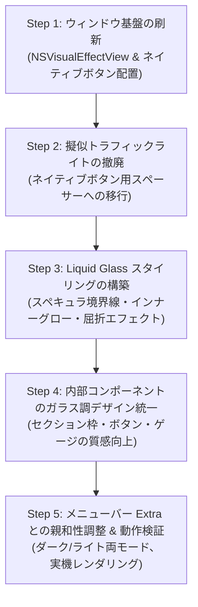

# ウィンドウのmacOS標準UI化 & Liquid Glass（流体ガラス）対応 刷新計画

## 1. 現状の分析と課題

現在 AIMeter のデスクトップウィジェットおよびメニューバーUIは以下の実装になっています：

1. **トラフィックライトの擬似実装**
   - `AIMeterApp.swift` 内でネイティブの閉じる・最小化・拡大ボタンを `.isHidden = true` で隠し、SwiftUIの `Circle()` を使った自作の擬似ボタン（赤・黄）を描画しています。
   - そのため、macOSネイティブのホバー挙動、ウィンドウ非アクティブ時のグレーアウト、システムアクセントカラー、アクセシビリティ対応、Optionキー押下による挙動などが機能していません。
2. **背景マテリアルの単調さ（ガラス質感の不足）**
   - 単一の `.regularMaterial` に薄い枠線を乗せているのみで、macOS Sonoma / Sequoia や次世代 macOS (Tahoe) / visionOS で見られるような「Liquid Glass（光沢のあるハイライト、エッジの屈折、厚みのある流体ガラスの透明感）」になっていません。
3. **ウィンドウとコンテンツの統合**
   - ウィンドウのフレームと内部のカードビューの境界が分離しており、macOS標準のタイトルバー領域（ドラッグエリアやネイティブボタン位置）と少しズレが生じる可能性があります。

---

## 2. 刷新の設計方針

### 方針1: macOS標準UIへの完全準拠
- **ネイティブ・トラフィックライトの復活**:
  - 自作の擬似丸ボタンを廃止し、`NSWindow.standardWindowButton`（赤・黄・緑）を正規に利用。
  - タイトルバーをシームレスに統合（`.titlebarAppearsTransparent = true`、フルサイズコンテンツビュー）し、標準ボタンが適切なマージンで左上に綺麗に配置されるレイアウトにします。
- **標準的なウィンドウコントロール & 操作性**:
  - ウィンドウヘッダーのドラッグ移動、ダブルクリックによる最小化/ズームなどの macOS 標準ジェスチャーをネイティブにサポート。
  - キーボードショートカット（⌘W、⌘M、ESC）との完全な調和。

### 方針2: Liquid Glass（流体ガラス / Glassmorphism）の実装
最新の Apple デザイン言語を取り入れ、高品質なガラス質感を構築します：

1. **多重レイヤーの動的ブラー（Dynamic Vibrancy & Blur）**:
   - ウィンドウ背景に `NSVisualEffectView`（`.behindWindow` ブレンディング、`.hudWindow` / `.popover` マテリアル）を基盤として敷き、背面のデスクトップ壁紙や背後ウィンドウを滑らかに屈折・透過させます。
2. **スペキュラ・ハイライト（Specular Edge Lighting）**:
   - 上部および左上から光が当たって反射しているかのような 1px の微細なシアーグラデーション枠線（上部: 30%〜40% ホワイト、下部: 8%〜15% ホワイト）を適用し、ガラスの屈折面を表現。
3. **ガラスの厚み・立体感（Depth & Inner Glow）**:
   - 内部に微かなソフトアンビエントシャドウ（インナーシャドウ）を入れ、単なる半透明シートではなく「一枚の厚いクリスタルガラス」のような深みを与えます。
4. **階層化フロストカード（Layered Frosted Surfaces）**:
   - 各サービス（OpenAI, Gemini, Claude, Copilot等）のセクションやボタンも、背面ガラスの上に薄いすりガラスパネル（Ultra Thin Glass Capsule）として浮かび上がるデザインに統一。

---

## 3. 実装ステップ

### 【Step 1】ウィンドウ基盤の刷新（`DesktopWidgetWindowAccessor`）
- `window.standardWindowButton(.closeButton)?.isHidden = false` に戻す。
- `window.standardWindowButton(.miniaturizeButton)?.isHidden = false` に戻す。
- `window.styleMask.insert([.titled, .fullSizeContentView, .closable, .miniaturizable])` を適用し、タイトルバー領域をコンテンツに溶け込ませる。
- `NSVisualEffectView` を `window.contentView` の背景レイヤーに組み込み、システム標準のバイブランシー（Vibrancy）を有効化。

### 【Step 2】擬似トラフィックライトの撤廃
- `AIMeterApp.swift` の `MacWindowTrafficLights` を削除。
- ヘッダー左側にはネイティブのトラフィックライトが収まる余白（トラフィックライトインセット約 70pt）を確保し、タイトル「AIMeter」とツールボタン群を配置。

### 【Step 3】Liquid Glass モディファイア（`LiquidGlassBackground`）の作成
- 再利用可能な SwiftUI ViewModifier / ShapeStyle として `LiquidGlassCard` を実装：
  - ベース: 超微細ブラー（`.ultraThinMaterial` / `NSVisualEffectView`）
  - ハイライト: 上部光沢グラデーションボーダー（`LinearGradient(colors: [.white.opacity(0.4), .white.opacity(0.1)], startPoint: .topLeading, endPoint: .bottomTrailing)`）
  - シャドウ: 自然なアンビエントシャドウ（半径 16〜24pt、透明度 15%）＋薄いインナーハイライト。

### 【Step 4】内部コンポーネントのガラス調デザイン統一
- 各プロバイダーセクション（`ProviderUsageSection`）のカード背景を、Liquid Glass にマッチしたフロストカプセル背景に更新。
- プログレスバー（メーター）の発光感を高め、ガラス越しにネオンやバーが綺麗に透けて見えるように調整。
- 「要点 / 全枠」「更新」「設定」ボタンもガラスボタン（Glass Morphic Button）として統一。

### 【Step 5】検証とブラッシュアップ
- `swift build` およびローカル実行での外観確認。
- ライトモード / ダークモード双方での視認性・コントラスト（アクセシビリティ）の確認。
- ウィンドウのドラッグ、最小化、復帰、ピン留め（常に手前に表示）の動作確認。
